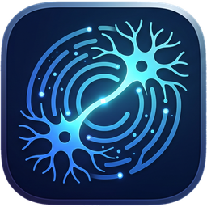

<p align="center"></p>

# engram

[](https://github.com/cmjcode/engram/actions/workflows/ci.yml)
[](https://github.com/cmjcode/engram/releases)
[](LICENSE)
[](https://registry.modelcontextprotocol.io/?q=io.github.cmjcode/engram)

🇮🇩 Bahasa Indonesia · [🇬🇧 English](README.en.md)

**Engram** adalah memori jangka panjang lintas-tool untuk agent AI dan untuk manusia di belakangnya:
keputusan arsitektur, akar masalah bug, konvensi kerja, sampai kisah hidup dan silsilah keluarga,
tersimpan lokal (SurrealDB embedded, satu binary Rust) dan diakses lewat MCP dari Claude Code,
Codex, Cursor, Antigravity, Gemini CLI, Windsurf, atau VS Code.

> *Bitemporal, evidence-backed, local-first memory for coding agents and life stories.*
> Bukan proyek yang sama dengan "Engram" versi Go/SQLite di registry MCP; yang ini berfokus pada
> fakta bertanda waktu, graf entitas, dan prinsip yang didukung bukti.

## Mengapa engram (pembeda dari memory server MCP lain)

| Kemampuan | engram | Memory server pada umumnya |
| --- | --- | --- |
| **Fakta bitemporal** | Setiap fakta punya `valid_from`/`valid_to`; hasil tool memisahkan *berlaku sekarang* vs *dulu*, dan `as_of` menampilkan memori sebagaimana pada tanggal itu | Fakta menimpa fakta lama tanpa jejak, atau hanya *timestamp* penyimpanan |
| **Graf entitas + silsilah** | Orang, proyek, komponen, tool, organisasi, tempat sebagai entitas beralias; relasi kekerabatan turunan (sepupu, mertua, ipar) dihitung dari relasi yang diceritakan | Potongan teks ber-embedding, tanpa entitas atau relasi |
| **Prinsip berbukti** | `principles` hanya mengembalikan pola keputusan yang didukung beberapa episode nyata, dengan sitasi `[ep:ID]` | Tidak ada lapisan "kebijaksanaan"; hanya fakta |
| **Pemadatan non-destruktif** | `compact` merangkum klaster episode menjadi episode kanonik; episode asli ditandai *retelling*, bukti tetap utuh dan bisa ditelusuri | Ringkasan menimpa sumber, atau tidak ada pemadatan |
| **Graf proyek bergaya Obsidian** | Proyek saling ditautkan dengan `[[Nama-Proyek]]` (di catatan proyek atau teks `remember` agent), plus sebutan otomatis, tag grup, dan tool bersama; halaman *Graf proyek* menampilkannya sebagai bola 3D yang bisa diputar (atau 2D) dengan panel detail, warna per tag grup, filter aktivitas, dan backlink | Daftar memori datar tanpa relasi antar proyek |
| **Konteks proyek siap pakai** | `project_context` merangkai fakta arsitektur aktif, keputusan, bug fix, prinsip, dan sesi terkait satu repositori untuk awal sesi koding (disuntik otomatis lewat hook `SessionStart`) | Agent harus merangkai sendiri dari hasil pencarian |
| **Penyaringan sebelum simpan** | Pipeline skor memilah basa-basi dari keputusan/fakta penting; evaluasinya terukur dengan `engram bench eval` | Semua pesan masuk apa adanya |
| **Kedaulatan data** | Lokal, format terbuka, AGPL; sinkronisasi opsional ke Google Drive milik sendiri | Cloud vendor, langganan |

Kepatuhan MCP: Streamable HTTP tanpa sesi (spesifikasi 2026-07-28; klien 2024-11-05 s/d 2025-11-25 tetap diterima),
`tools/list` dengan `title`, `annotations` (`readOnlyHint` dkk.) dan `outputSchema` untuk tiap tool, `structuredContent`
pada hasil, plus profil tool `coding` agar sesi koding tidak dipenuhi tool memori hidup.

## Instalasi

macOS / Linux — memasang CLI `engram` dan aplikasi desktop `engram`:

```sh
curl -fsSL https://raw.githubusercontent.com/cmjcode/engram/main/install.sh | sh
```

Opsi: `--cli-only`, `--desktop-only`, `--version 0.0.2`, `--bin-dir ~/bin`, `--appimage` (Linux), misalnya
`curl -fsSL .../install.sh | sh -s -- --cli-only`. CLI dipasang ke `~/.local/bin`; aplikasi macOS ke `/Applications`,
Linux lewat `.deb`/`.rpm` (atau AppImage bila tanpa sudo). Windows: unduh `.exe`/`.msi` dari
[Releases](https://github.com/cmjcode/engram/releases).

**Docker / MCP Registry.** Binary yang sama diterbitkan sebagai image `ghcr.io/cmjcode/engram` dan terdaftar di
MCP Registry resmi sebagai `io.github.cmjcode/engram` (`server.json`), sehingga client yang membaca registry bisa
memasangnya langsung.

```sh
# server: UI, REST API, dan MCP Streamable HTTP di :7878
docker run -d --name engram -p 127.0.0.1:7878:7878 -v engram-data:/data -e MEMORY_TOKEN="$(openssl rand -hex 24)" ghcr.io/cmjcode/engram
# server MCP stdio untuk client yang menjalankan prosesnya sendiri
docker run -i --rm -v engram-data:/data ghcr.io/cmjcode/engram mcp --profile coding
```

Saat pertama jalan, container menyalin `memory.toml.example` ke `/data/memory.toml`; arahkan `[llm]` dan `[embedding]`
ke server OpenAI-compatible Anda (vLLM, TEI, Ollama, …) atau set `provider = "hash"` untuk uji coba offline.

**Update otomatis.** Aplikasi desktop memeriksa rilis baru tak lama setelah dibuka dan setiap 6 jam, atau
lewat menu tray **Periksa update**. Update dipasang setelah disetujui, lalu aplikasi dibuka ulang. Paket update
ditandatangani; kunci privatnya `~/.tauri/engram.key` (dipakai `build.sh`, dan harus disimpan juga
sebagai secret GitHub `TAURI_SIGNING_PRIVATE_KEY`). Manifest `latest.json` disusun oleh
`scripts/updater-manifest.sh`. CLI `engram` belum ikut update otomatis; jalankan ulang `install.sh`.

## Integrasi Agent AI (MCP, Rule & Hook Otomatis)

`engram` dapat dihubungkan ke **Antigravity (IDE & CLI)**, **Gemini CLI**, **Claude Code**, **Cursor**, **Codex CLI**,
**Windsurf**, dan **VS Code** sehingga setiap percakapan penting otomatis tersimpan ke engram dan konteks masa lalu dapat diambil kapan saja:

```sh
# Pasang MCP server, Global Rule, dan Hook otomatis ke semua client yang terinstal
./scripts/install-mcp.sh --client all

# Atau pilih client tertentu: antigravity | gemini | claude | cursor | codex | windsurf
./scripts/install-mcp.sh --client codex

# Timpa profil tool (bawaan: coding untuk cursor/codex/windsurf, full untuk yang lain)
./scripts/install-mcp.sh --client cursor --profile full

# Hapus integrasi dari semua client
./scripts/install-mcp.sh --uninstall --client all
```

Skrip berjalan di macOS dan Linux. Di Windows pakai panel **Integrasi** di aplikasi desktop, yang melakukan hal yang
sama lewat installer bawaan `engram` (`crates/memory-server/src/install.rs`, juga tersedia sebagai
`POST /api/mcp/clients/{id}/install`).

Apa saja yang dipasang oleh `scripts/install-mcp.sh`:

1. **Server MCP (`engram`)**: Menyediakan tool `project_context`, `recall`, `remember`, `who_is`, `timeline`, `principles`, `persona_context`, `family_tree`, `memory_gaps`, `list_subjects`, dan `compact` lewat Streamable HTTP (`http://127.0.0.1:7878/mcp`) dengan token tetap `MEMORY_TOKEN` (`LaunchAgent` `id.engram.ai.token`). Tambahkan `?profile=coding` (atau `engram mcp --profile coding` untuk stdio) agar hanya tujuh tool sesi koding yang dimuat: `project_context`, `recall`, `get_episodes`, `remember`, `who_is`, `timeline`, `principles`. Codex memakai `~/.codex/config.toml` (`[mcp_servers.engram]`), Windsurf `~/.codeium/windsurf/mcp_config.json`.
2. **Global Rule (`GEMINI.md`, `CLAUDE.md`, `AGENTS.md`, `global_rules.md`)**: Menginstruksikan agent di `~/.gemini/GEMINI.md`, `~/.gemini/config/GEMINI.md`, `~/.claude/CLAUDE.md` (rule penuh), serta `~/.codex/AGENTS.md` dan `~/.codeium/windsurf/memories/global_rules.md` (rule ringkas profil coding) agar proaktif memanggil `project_context`/`recall` di awal tugas dan `remember` setelah keputusan penting.
3. **Hook Otomatis (`~/.local/bin/engram-auto-remember`)**:
   * Dipasang pada event `Stop` di Antigravity (`~/.gemini/config/hooks.json`) dan Claude Code (`~/.claude/settings.json`), serta `AfterAgent` di Gemini CLI (`~/.gemini/settings.json`).
   * **Hook `SessionStart`** untuk Claude Code dan Gemini CLI: saat sesi dibuka, konteks proyek (indeks ber-ID dari `GET /api/subjects/{s}/context/inject`, batas `inject.max_chars`) disuntik sebagai konteks awal. Installer memakai `engram hook <client> context` bila binary `engram` tersedia; `scripts/session-context-hook.py` (`~/.local/bin/engram-session-context`) adalah cadangan Python yang memanggil endpoint yang sama, dan jatuh ke `project_context` pada server lama. Bila server mati atau proyek belum punya catatan, hook diam.
   * Setiap giliran percakapan selesai, script `scripts/auto-remember-hook.py` otomatis mengekstrak pesan pengguna & balasan asisten dari transkrip, menyaring duplikat, lalu mengirimnya ke pipeline `remember` (yang akan menyaring obrolan basa-basi lewat konfigurasi `[score]`).
   * **Fallback Offline**: Bila aplikasi desktop / `engram serve` sedang tidak aktif, percakapan otomatis disimpan sebagai berkas `.md` ke `vault/inbox/` untuk diimpor otomatis begitu aplikasi dibuka kembali.

## Benchmark

Angka di bawah dari `engram bench` (penyimpanan episode + latensi pencarian vektor/BM25 pada SurrealDB
embedded RocksDB, vektor acak, tanpa LLM) di mesin pengembangan; jalankan ulang di mesin Anda dengan
perintah yang sama:

```sh
engram --config memory.toml bench --episodes 20000 --queries 200
```

<!-- BENCH_START -->
Hasil 5 Nov 2026, Apple Silicon (macOS), engram 0.0.16, 20.000 episode, dimensi vektor 1024, index HNSW:

| Ukuran | Hasil |
| --- | --- |
| Tulis episode | 16,8 dtk total, 1.188 episode/detik (menurun dari 1.728/detik pada 5.000 pertama karena pemadatan indeks) |
| Pencarian vektor top-10 | p50 33,0 ms, p95 45,7 ms, p99 1.836 ms (p99 terjadi saat indeks HNSW masih mengejar tulisan) |
| BM25 top-10 | p50 998 ms, p95 1.320 ms |
| Ukuran di disk | 470,9 MB |
<!-- BENCH_END -->

Kualitas penyaringan (apakah potongan penting lolos dan basa-basi terbuang) diukur terpisah dengan set emas
buatan sendiri: `engram bench export-gold --out kasus/` untuk mengekspor kandidat dari vault, beri label
`important` di `gold.toml`, lalu `engram bench eval kasus/` (presisi/recall/leak) dan `engram bench tune kasus/`
untuk mencari ambang `[score]` terbaik secara offline dari cache segmentasi.

## Lanskap produk sejenis

**1\. Kategori "AI Legacy & Biographer" (Fokus ke Konsumen/Keluarga)** Platform ini memang dibuat khusus untuk merekam kisah hidup, suara, dan kenangan seseorang untuk diwariskan ke anak-cucu.

> * **HereAfter AI & StoryFile:** Mengambil pendekatan wawancara interaktif. Pengguna menjawab ratusan pertanyaan tentang hidup mereka (via audio/video). Nantinya, keluarga bisa "mengobrol" dengan rekaman tersebut. *Kelemahannya:* Arsitektur di belakangnya masih sangat kaku (mirip sistem pencocokan Q\&A berbasis RAG sederhana), belum menjadi *cognitive engine* yang benar-benar bisa berpikir dengan pola pikir orang tersebut.  
> * **Eternos.life & Personal.ai:** Lebih maju karena membangun *Personal Language Model* dan *Memory Stack* dari kisah hidup pengguna. *Kelemahannya:* Semuanya berbasis *cloud proprietary* (data hidupmu dikunci di server mereka dengan biaya langganan mahal) dan kurang mendalam dalam memetakan perubahan sifat manusia secara kronologis (*temporal graph*).

**2\. Kategori "Active Lifelogging" (Perekam Aktivitas Real-Time)** Platform yang fokus merekam semua yang dilihat dan didengar pengguna sehari-hari.

> * **Limitless (dulunya Rewind.ai) & Omi (Friend):** Menggunakan perangkat *wearable* (kalung/pendant) dan perekam layar untuk mencatat seluruh rapat, obrolan, dan aktivitas harian ke dalam database vektor lokal/cloud.  
> * *Kelemahannya:* Sistem ini hebat untuk menjawab *"Tadi pagi aku ngobrol apa sama Budi?"*, tapi buruk untuk merangkum masa lalu. Mereka kebanjiran data sampah harian (*noise*) dan tidak punya arsitektur untuk mengekstrak kebijaksanaan (*wisdom*), nilai hidup, atau menyusun cerita masa kecil 30 tahun lalu.

**3\. Kategori "Developer Memory Infrastructure" (Engine di Balik Layar)** Jika melihat dari sisi *engine* pembangunnya (bukan aplikasi jadi untuk konsumen), beberapa *startup* infrastruktur AI sedang berlomba di area ini:

> * **Zep (dengan engine *Graphiti*\-nya) & Cognee:** Dua *framework* ini paling mendekati secara teknis karena sudah menggunakan **Temporal Knowledge Graph**. Mereka bisa melacak kapan sebuah fakta mulai berlaku dan kapan kedaluwarsa.  
> * **Mem0 & Letta (MemGPT):** Sangat kuat di manajemen *state* dan memori jangka panjang untuk *enterprise agent*, tapi didesain untuk asisten kerja/komersial, bukan untuk memodelkan psikologi, emosi, dan fase kehidupan manusia.  
> * **Evermind (EverOS) & Supermemory:** Fokus pada *Memory OS* yang menggabungkan dokumen, chat, dan *multi-modal retrieval* untuk memori jangka panjang.

**Celah Besar yang Belum Terpecahkan (Peluang Kalau Mau Bangun Sendiri)**

Jika kamu ingin membangun ini sendiri, kamu tidak sedang membuat ulang roda—kamu justru bisa mengisi lubang besar yang belum disentuh pemain di atas:

> 1. **Kedaulatan Data (*Self-Hosted & Sovereign* untuk 50+ Tahun):** Kisah hidup dan warisan pemikiran keluarga adalah data paling sensitif. Menyimpannya di *startup SaaS* luar negeri sangat berisiko (kalau *startup*\-nya bangkrut 5 tahun lagi, arsip memori itu hilang). Sistem *local-first* atau *self-hosted* dengan format penyimpanan terbuka adalah keharusan untuk *legacy system*.  
> 2. **Pemodelan Karakter & Prinsip Hidup (*Wisdom Layer*):** Platform yang ada sekarang baru sebatas menyimpan **Fakta** (*"Dia pernah merintis usaha di Jogja tahun 2015"*). Belum ada yang secara khusus mengekstrak **Pola Keputusan/Prinsip** (*"Setiap kali menghadapi krisis bisnis, orang ini selalu memprioritaskan kesejahteraan timnya dulu baru menghitung rugi materi, karena dipengaruhi didikan ibunya"*).  
> 3. **Konteks Budaya & Bahasa Lokal:** Orang Indonesia bercerita dengan struktur yang unik—banyak kiasan, percampuran bahasa daerah (Jawa/Sunda/dll), dan struktur silsilah keluarga besar yang rumit. Platform Barat sering gagal menangkap nuansa emosional dan relasi kekerabatan ini.


## Memori sesi kerja agent (hook `engram hook`)

Selain tool MCP, engram merekam **sesi kerja** agent AI secara otomatis lewat hook tipis
`engram hook <client> <event>` (binary yang sama, tidak membuka vault, selalu keluar 0,
menyimpan event ke spool `hook-spool/` bila server mati dan mengirim ulang pada panggilan
berikutnya). `scripts/install-mcp.sh --client claude` memasangnya ke Claude Code:

| Hook Claude Code | Event engram | Fungsi |
|---|---|---|
| `SessionStart` | `context` | menyuntik **indeks** memori proyek (ID, tanggal, jenis, judul, perkiraan token), ≤ `inject.max_chars` |
| `UserPromptSubmit` | `session-init` | mencatat sesi, nomor prompt, dan prompt (setelah penyaring privasi) |
| `PreToolUse` (Read/Edit/Write) | `file-context` | riwayat berkas dari memori, sekali per sesi per berkas; tidak pernah memblokir |
| `PostToolUse` / `PostToolUseFailure` | `observation` | satu pemanggilan tool ke spool giliran (dipangkas 64 KB, gambar dibuang, rahasia diredaksi) |
| `Stop` / `PreCompact` | `summarize` | giliran menjadi sumber `agent_session`; LLM mengekstrak observasi bertipe (`decision`, `bugfix`, `discovery`, `feature`, `refactor`, `change`) + ringkasan sesi (permintaan, diselidiki, dipelajari, selesai, langkah berikut) + **pelajaran** proyek |
| `SessionEnd` | `session-end` | menutup sesi |

Gemini CLI (`AfterAgent`) dan Antigravity (`Stop`) memakai event `turn` (prompt + jawaban tanpa tool).
Proyek ditentukan dari **akar repositori git** (worktree dipetakan ke repo induknya), bukan sekadar nama folder.

Agent mengambil memori secara bertahap: `recall` (indeks ringkas) → `timeline(anchor)` → `get_episodes(ids)`;
semua tool MCP dibatasi anggaran token (`budget`). Tag `<private>…</private>` di prompt tidak pernah disimpan,
dan rahasia (API key, token, PEM, kredensial URL) diganti `<redacted type='…'/>` sebelum masuk vault
(`[privacy]` di `memory.toml`).

Perintah terkait:

```sh
engram import-claude-memory --all --apply   # auto-memory Claude Code (~/.claude/projects/*/memory/*.md) -> episode, tanpa LLM
engram repo init [--hooks]                  # aktifkan memori tim lewat repo ini (.engram/), lalu commit foldernya
engram repo status                          # anggota, impor/ekspor terakhir, git hook terpasang
engram repo export [--dry-run]              # tulis memori proyek perangkat ini ke .engram/members/<anggota>/
engram repo import                          # gabungkan memori rekan tim ke vault ini (tidak menghapus)
```

### Memori tim lewat repositori git

Siapa pun yang punya akses ke repo otomatis berbagi memori proyeknya: konvensi & jebakan, keputusan,
dan fakta arsitektur. Tidak perlu server, akun, atau biaya tambahan; hak akses mengikuti akses repo.

- **Penyimpanan tetap SurrealDB embedded** di vault tiap anggota, jadi kecepatan `recall` tidak berubah.
  Folder `.engram/` di repo hanya jalur kirim-terima berisi teks terdistilasi (tanpa embedding,
  tanpa transkrip), biasanya puluhan KB per proyek.
- **Tanpa konflik merge**: tiap anggota per perangkat hanya menulis `.engram/members/<nama>-<hash>/`,
  satu berkas JSON per record.
- **Otomatis**: saat sesi agent dimulai engram menggabungkan perubahan `.engram/` (misalnya setelah
  `git pull`) dan menulis memori terbaru; `engram repo hooks` menambah git hook `post-merge`,
  `post-checkout`, dan `pre-commit`. engram tidak pernah melakukan `git commit` sendiri.
- **Privasi**: hanya memori milik proyek itu; teks yang memuat rahasia atau blok `<private>`
  dilewati, dan frasa di `exclude` pada `.engram/config.toml` tidak diekspor. Cek dulu dengan
  `engram repo export --dry-run`.

Panduan lengkap ada di [docs/PANDUAN.md](docs/PANDUAN.md#memori-tim-lewat-repositori-git).

Tampilan **Sesi & pelajaran** di UI memperlihatkan sesi, observasi, dan konvensi/koreksi/jebakan per proyek.
Pelajaran yang berulang di ≥ 2 proyek diangkat `engram distill` menjadi kandidat prinsip kerja (menunggu konfirmasi di Review).

## Pengembangan

```sh
cargo build --release -p memory-cli
cargo test --workspace --exclude memory-desktop
```

Lihat [CONTRIBUTING.md](CONTRIBUTING.md), [SECURITY.md](SECURITY.md), dan [CHANGELOG.md](CHANGELOG.md).
Panduan konfigurasi (`memory.toml`), aplikasi desktop, dan CLI ada di [docs/PANDUAN.md](docs/PANDUAN.md).

## Lisensi

[GNU Affero General Public License v3.0 atau lebih baru](LICENSE). Lisensi komersial tersedia atas permintaan.
